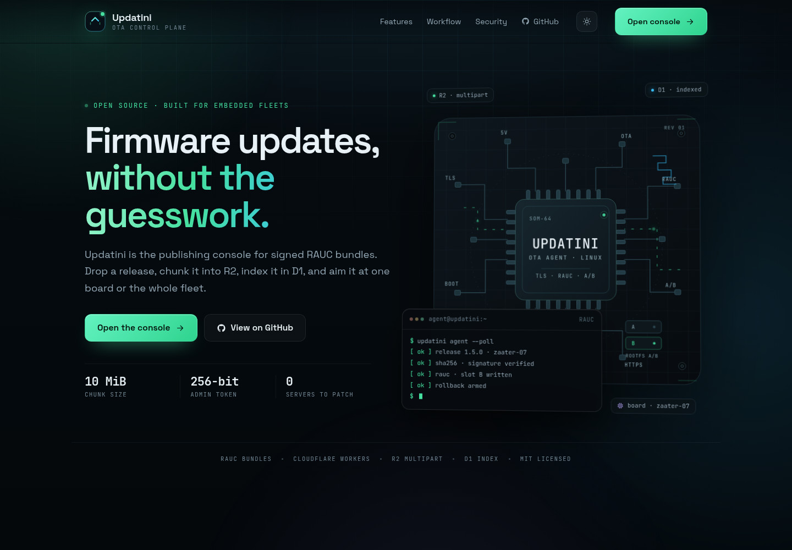
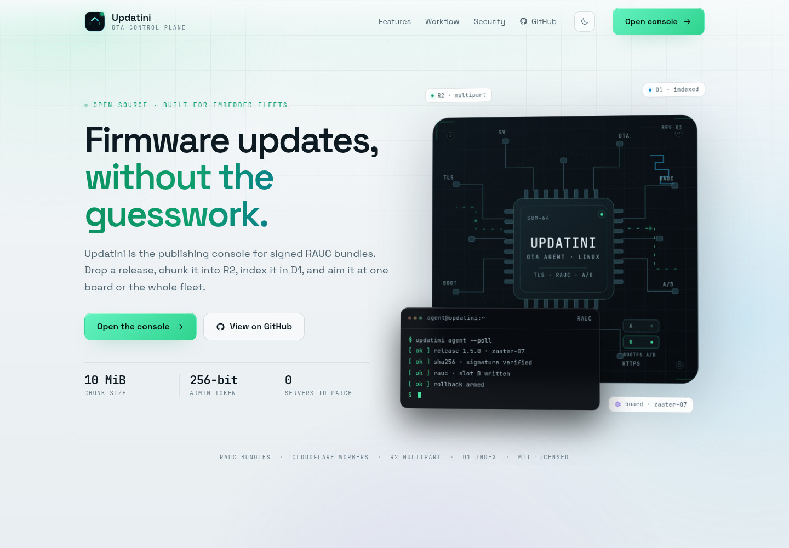
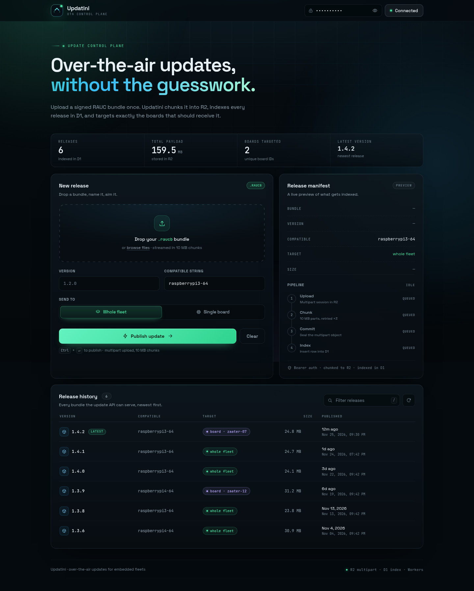
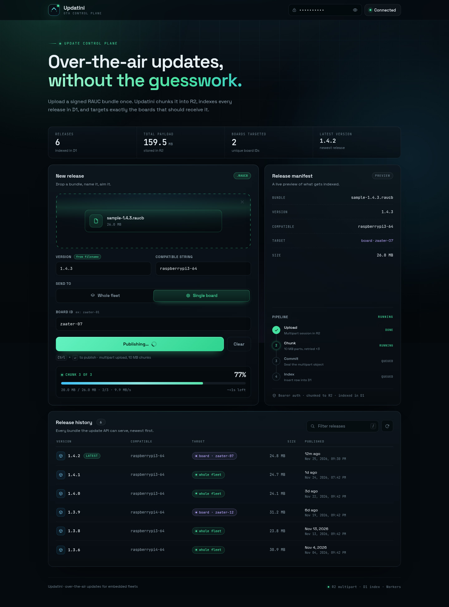
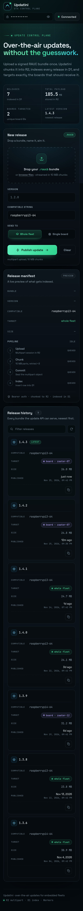
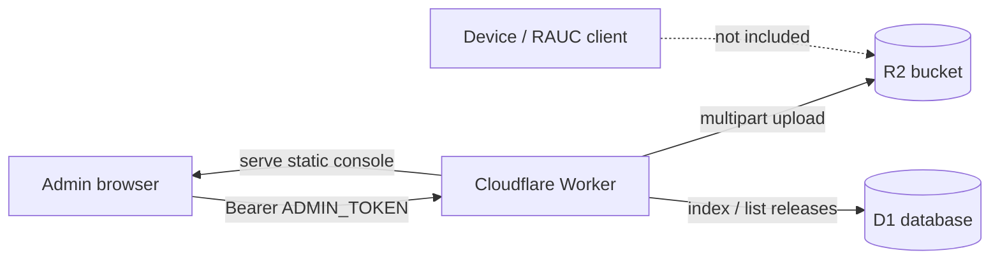

<div align="center">

# Updatini

**Open-source over-the-air update console for embedded systems.**

Publish signed RAUC bundles to Cloudflare R2, index every release in D1, and target one board or the whole fleet.

[](LICENSE)
[](https://workers.cloudflare.com/)
[](https://nodejs.org/)
[](public/)

</div>



> **Reference deployment:** [updatini.zaaterx.workers.dev](https://updatini.zaaterx.workers.dev) — protected by an admin token, so visitors only see the sign-in state.

## What this is

Updatini is the **publishing side** of an over-the-air firmware workflow for embedded Linux devices. You build a signed [RAUC](https://rauc.readthedocs.io/) bundle (`*.raucb`), upload it through this console, and choose whether it is offered to the whole fleet or to a single board ID.

The project runs entirely on Cloudflare's free-tier-friendly primitives:

- **Cloudflare Workers** — API and static asset delivery, no server to maintain
- **R2** — object storage for the firmware bundles, using true multipart uploads
- **D1** — a small SQL index of releases (version, compatible string, target, size, timestamp)
- **Vanilla HTML/CSS/JS** — no frontend build step, no framework, no dependencies shipped to the browser

The UI is a responsive "control plane" interface with **light and dark themes** (system preference on first visit, then a persistent toggle), a live upload pipeline, chunk progress, release history, search, and reduced-motion support.

<details>
<summary><strong>More screenshots</strong></summary>

### Light theme



### Console



### Multipart upload in progress



### Mobile layout



</details>

## Features

- **Chunked uploads** — the browser streams the bundle in 10 MiB parts, retries failed parts up to three times, and shows live throughput and ETA.
- **Targeted delivery metadata** — publish to `all` boards or a single `board:<id>`.
- **Release history** — newest first, with version, compatible string, target chip, size, relative timestamp, and the R2 object key.
- **Search and copy** — filter by version, board, compatible string, or key; copy a bundle key with one click.
- **Admin-token authentication** — a single bearer token guards every `/api/*` route.
- **Light and dark themes** — follows the operating-system preference on first visit, then remembers your choice; the sun/moon toggle is available on both the landing page and the console.
- **Responsive, accessible UI** — card layout on small screens, visible focus states, ARIA progress bar/live regions, and `prefers-reduced-motion` support.
- **No build step** — edit `public/` and reload; Wrangler handles bundling the Worker.

## Architecture



Every release is stored as an R2 object at `bundles/<timestamp>-<filename>` and recorded in the `bundles` table. The console only publishes and indexes bundles; the device-side update check and download endpoint are intentionally out of scope for now (see [Scope and roadmap](#scope-and-roadmap)).

## Tech stack

| Layer | Choice |
| --- | --- |
| API | Cloudflare Worker (`src/worker.js`, ES modules) |
| Storage | Cloudflare R2 (multipart uploads) |
| Index | Cloudflare D1 (`schema.sql`) |
| Frontend | Semantic HTML, modern CSS, vanilla JS (`public/`) |
| Tooling | Wrangler 4, Node.js 22.12+ |
| Scripts | Bash (`scripts/*.sh`) |
| Fonts | Space Grotesk + JetBrains Mono (Google Fonts, with system fallbacks) |

## Project structure

```text
.
├── public/                         # Static assets (served by Workers Assets)
│   ├── index.html                  # Landing page
│   ├── landing.css                 # Landing design + animations
│   ├── landing.js                  # Reveals, nav chrome, hero parallax
│   ├── theme.css                   # Shared toggle + theme crossfade
│   ├── theme.js                    # Theme persistence + system preference
│   ├── console/
│   │   └── index.html              # OTA console
│   ├── styles.css                  # Console design tokens, layout, animations
│   ├── app.js                      # Console upload flow, history, auth, UI state
│   └── favicon.svg
├── src/
│   └── worker.js                   # API: upload/start → part → finish, list releases
├── scripts/
│   ├── generate-admin-token.sh     # Generate + install ADMIN_TOKEN
│   ├── deploy.sh                   # Guard-railed wrangler deploy
│   └── lib.sh                      # Shared Wrangler helper
├── preview/                        # Screenshots used by this README
├── schema.sql                      # D1 table definition
├── wrangler.toml                   # Worker, assets, R2 and D1 bindings
├── package.json
├── .dev.vars.example               # Template for local secrets
└── LICENSE
```

## Quick start

### 1. Prerequisites

- **Node.js 22.12+** (Wrangler 4 requirement) and npm
- **Bash** for the helper scripts (Linux, macOS, or WSL/Git Bash on Windows)
- A Cloudflare account with Workers, R2 and D1 available
- A signed RAUC bundle to test with

```bash
git clone https://github.com/pycine/updatini.git
cd updatini
npm install
npx wrangler login
```

### 2. Create your Cloudflare resources

```bash
npx wrangler r2 bucket create updatini-bundles
npx wrangler d1 create updatini
```

`d1 create` prints a `database_id`. Edit `wrangler.toml` and replace the checked-in reference values:

```toml
[[r2_buckets]]
binding = "BUCKET"
bucket_name = "updatini-bundles"        # your bucket

[[d1_databases]]
binding = "DB"
database_name = "updatini"
database_id = "xxxxxxxx-xxxx-xxxx-xxxx-xxxxxxxxxxxx"  # your database id
```

> The values committed in `wrangler.toml` point at the reference deployment's resources. They are identifiers, not credentials, but forks must use their own.

Apply the schema:

```bash
npm run db:init
# if you renamed the database, run:
# npx wrangler d1 execute <your-db-name> --file=./schema.sql --remote
```

### 3. Generate the admin token

```bash
npm run token
```

The script generates 32 random bytes (64 hex characters), installs it as the `ADMIN_TOKEN` Worker secret, and prints the token **once**. Save it in a password manager.

### 4. Deploy

```bash
npm run deploy
```

Wrangler uploads the Worker and the contents of `public/`, then prints the `*.workers.dev` URL. Open it, choose **Open console**, paste the token into **Admin token**, and click **Connect**.

That is the whole setup. Later deployments are just `npm run deploy`.

## Scripts

The two helper scripts wrap Wrangler so the common tasks are one command and hard to get wrong.

| Command | Script | What it does |
| --- | --- | --- |
| `npm run token` | `scripts/generate-admin-token.sh` | Generates a fresh token, checks Wrangler login, writes it as the `ADMIN_TOKEN` secret via `wrangler secret bulk`, and prints it once. |
| `npm run token:local` | `scripts/generate-admin-token.sh --local` | Generates a fresh token and writes it to `.dev.vars` with `0600` permissions. Does not contact Cloudflare. |
| `npm run deploy` | `scripts/deploy.sh` | Verifies `wrangler.toml`, checks your Cloudflare login, warns if `ADMIN_TOKEN` is missing, then runs `wrangler deploy`. Extra flags are forwarded. |
| `npm run deploy:dry` | `scripts/deploy.sh --dry-run` | Bundles the Worker locally without deploying or requiring login. Used by CI. |
| `npm run dev` | Wrangler | Starts the local Worker + assets server at `http://localhost:8787`. |
| `npm run db:init` | Wrangler | Applies `schema.sql` to the remote D1 database. |
| `npm run db:init:local` | Wrangler | Applies `schema.sql` to the local D1 emulation. |
| `npm run check` | Node | Syntax-checks the Worker and the browser app. |

### Why the token script exists

`wrangler secret put ADMIN_TOKEN` is interactive and easy to get wrong — for example, pasting the token at the *secret name* prompt instead of the *value* prompt. The script avoids that:

1. Generates the value locally with `crypto.randomBytes(32)`.
2. Sends it to `wrangler secret bulk` over **stdin** as JSON (`{"ADMIN_TOKEN":"…"}`), never in `wrangler.toml` or an argument list.
3. Prints it once for you to store.
4. Keeps `.dev.vars` out of Git (see `.gitignore`).

The token is never written to the repository. The only local write is on `--local`, which is the intentionally ignored `.dev.vars` file.

## Admin token lifecycle

- There is exactly **one** valid token at a time: the Worker secret `ADMIN_TOKEN`.
- Running `npm run token` rotates it. The old token stops working immediately and any connected tab must reconnect.
- Cloudflare never shows a secret's value again. If you lose the token, rotate it with `npm run token`.
- To remove the secret entirely: `npx wrangler secret delete ADMIN_TOKEN` (the API will then return `401` for everyone).
- The browser keeps the token in `sessionStorage` for the current tab only — not in a cookie and not on the server.

### Manual alternative

If you prefer the raw Wrangler flow:

```bash
# generate a token
openssl rand -hex 32

# store it (paste at the value prompt)
npx wrangler secret put ADMIN_TOKEN

# deploy
npx wrangler deploy
```

## Local development

```bash
npm run token:local     # writes ADMIN_TOKEN to .dev.vars
npm run db:init:local   # creates the bundles table in local D1
npm run dev             # http://localhost:8787
```

Wrangler runs the Worker locally with local R2 and D1 emulation. The landing page is at `http://localhost:8787/` and the console at `http://localhost:8787/console/`. Uploads work against the local `.wrangler/state` directory, so you can test the full publish flow without touching production data.

To use the real remote resources while developing:

```bash
npx wrangler dev --remote
```

Do not commit `.dev.vars`. The example in `.dev.vars.example` is only a template.

## API

All `/api/*` routes require:

```http
Authorization: Bearer <ADMIN_TOKEN>
```

| Method | Path | Purpose |
| --- | --- | --- |
| `POST` | `/api/upload/start` | Create an R2 multipart upload. Body: `{ "name": "app-1.4.3.raucb" }`. Returns `{ key, uploadId }`. |
| `PUT` | `/api/upload/part?key=…&id=…&n=1` | Upload one binary part as the raw request body. Returns R2's `{ partNumber, etag }`. Parts (except the last) should be at least 5 MiB; the UI uses 10 MiB. |
| `POST` | `/api/upload/finish` | Complete the multipart upload and insert the release. |
| `GET` | `/api/bundles` | List every release, newest first. |

`finish` body:

```json
{
  "key": "bundles/1795376967800-app-1.4.3.raucb",
  "uploadId": "…",
  "parts": [{ "partNumber": 1, "etag": "…" }],
  "version": "1.4.3",
  "compatible": "raspberrypi3-64",
  "target": "all",
  "size": 26014592
}
```

`target` is either `"all"` or `"board:<id>"`. The Worker validates it with `/^(all|board:[\w.-]{1,64})$/`.

List a releases index:

```bash
export ADMIN_TOKEN=your-token
curl "https://<your-worker>.workers.dev/api/bundles" \
  -H "Authorization: Bearer $ADMIN_TOKEN"
```

## Configuration

| Setting | Location | Notes |
| --- | --- | --- |
| `ADMIN_TOKEN` | Worker secret | Single bearer token for `/api/*`. Set with `npm run token`. |
| `BUCKET` | `wrangler.toml` | R2 binding used for multipart uploads. |
| `DB` | `wrangler.toml` | D1 binding used for the release index. |
| `assets.directory` | `wrangler.toml` | `public/` is served as static assets. |
| `assets.run_worker_first` | `wrangler.toml` | Only `/api/*` goes through the Worker; the rest is served as static files. |

The D1 schema:

```sql
CREATE TABLE IF NOT EXISTS bundles (
  id INTEGER PRIMARY KEY AUTOINCREMENT,
  key TEXT NOT NULL,
  version TEXT NOT NULL,
  compatible TEXT NOT NULL,
  target TEXT NOT NULL DEFAULT 'all',   -- 'all' or 'board:<id>'
  size INTEGER,
  created_at INTEGER NOT NULL
);
```

## Security

- The admin token is a **bearer secret**. Anyone who has it can publish firmware metadata and upload bundles.
- The static console is public; the API is not. Without a valid token, `/api/*` always returns `401`.
- Bundles are stored in a private R2 bucket; this repository exposes no download route.
- Do not commit `.dev.vars`, `.env`, tokens, or Cloudflare credentials. `.gitignore` covers the common cases.
- For a hardened deployment, put Cloudflare Access in front of the console and add rate limiting in front of `/api/*`.
- Rotate the token if it is ever exposed (screen share, shell history, CI logs) with `npm run token`.
- RAUC signature verification happens on the device. This console stores the bundle; it does not sign it.

## Scope and roadmap

This repository is deliberately focused. Current limitations:

- **The device-facing side is not included.** There is no "check for update" or bundle-download endpoint yet. A device client needs an endpoint that authenticates the board, matches `compatible` and `board:<id>`, and serves the selected R2 object.
- **Single admin token** — no user accounts, roles, or per-user audit trail.
- **No delete/revoke UI** — releases can only be added (for now).
- **No pagination** — the history list loads all rows.
- **No bundle signing** — bundles are expected to be signed by your RAUC build pipeline.

Good first contributions: a device update-check endpoint, a delete/revoke operation with confirmation, pagination, and audit logging.

## Contributing

Contributions are welcome. See [CONTRIBUTING.md](CONTRIBUTING.md) for the local setup, conventions, and the pre-PR checklist.

- Keep the frontend dependency-free and build-step-free.
- Run `npm run check` and `npm run deploy:dry` before opening a pull request.
- Never commit secrets. Use `npm run token:local` for development.
- For security issues, use the private process in [SECURITY.md](SECURITY.md) instead of a public issue.

## License

[MIT](LICENSE) © 2026 Muhammad Yacin

## Credits

- [RAUC](https://rauc.readthedocs.io/) — robust update framework for embedded Linux
- [Cloudflare Workers](https://workers.cloudflare.com/), [R2](https://developers.cloudflare.com/r2/), [D1](https://developers.cloudflare.com/d1/)
- Space Grotesk and JetBrains Mono (SIL Open Font License), served via Google Fonts with system fallbacks

Built by [@pycine](https://github.com/pycine).
